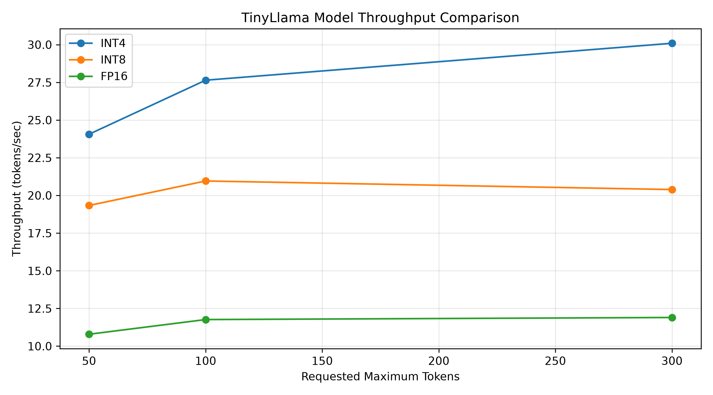
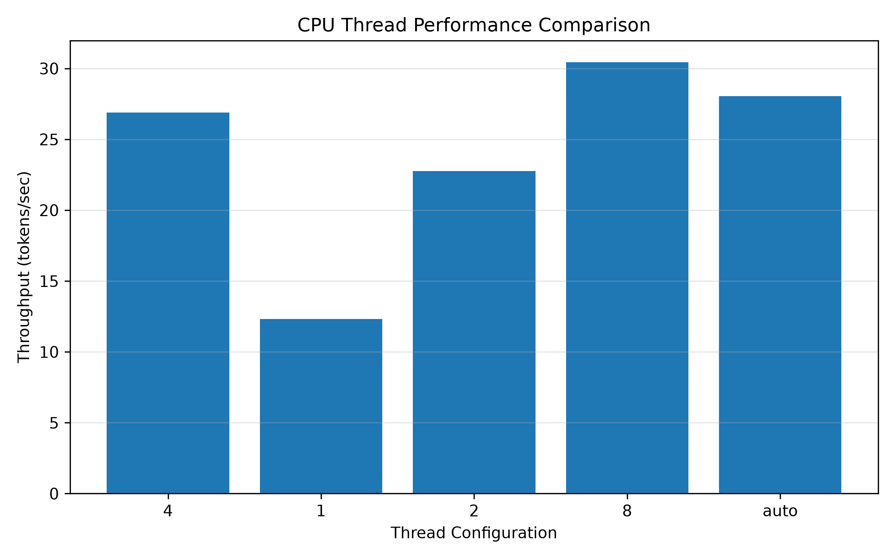
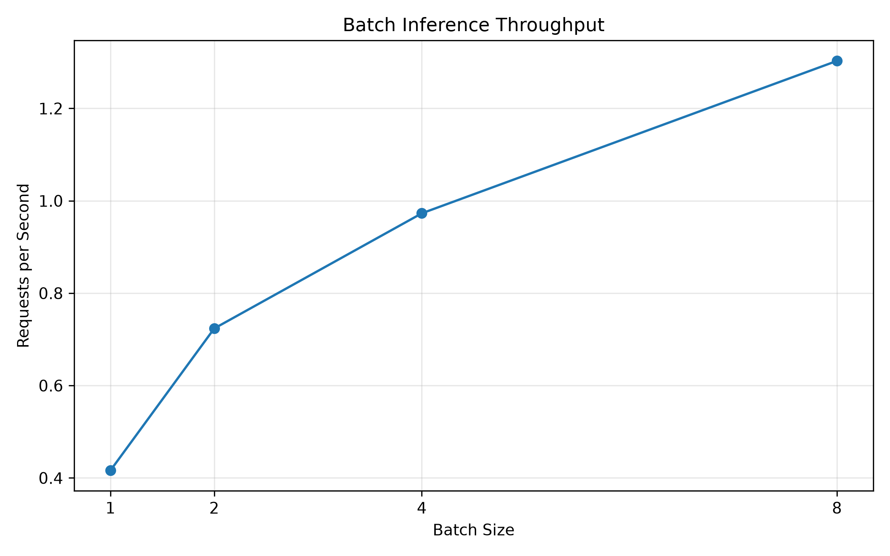

# TinyLlama LLM Inference with OpenVINO GenAI

A CPU-based Large Language Model (LLM) inference project using **C++, OpenVINO GenAI, and TinyLlama 1.1B Chat**.

This project explores local LLM deployment, model quantization, inference performance, CPU thread scaling, batch inference, and KV-cache memory behavior.

## Project Overview

The project implements a command-line application for running TinyLlama locally using OpenVINO GenAI.

It supports three model precision formats:

- **INT4** – 4-bit weight quantization
- **INT8** – 8-bit weight quantization
- **FP16** – 16-bit floating-point precision

The application provides single-prompt inference, interactive chat, streaming output, and benchmark execution.

## Features

- C++17 inference application using OpenVINO GenAI.
- TinyLlama 1.1B Chat model support.
- INT4, INT8, and FP16 model comparison.
- Interactive chat with conversation history.
- Streaming text generation.
- Configurable inference threads.
- LATENCY and THROUGHPUT performance hints.
- Inference performance metrics.
- Benchmark CSV exports.
- Performance visualization using Python and Matplotlib.
- KV-cache inspection and memory analysis.

## Project Structure

```text
ov-llm/
│
├── src/
│   └── main.cpp
│
├── charts/
│   ├── model_comparison.png
│   ├── thread_throughput.png
│   └── batch_throughput.png
│
├── models/                         # Not tracked by Git
│   ├── tinyllama-int4/
│   ├── tinyllama-int8/
│   └── tinyllama-fp16/
│
├── bench.py
├── thread_bench.py
├── batch_bench.py
├── generate_charts.py
│
├── benchmark_results.csv
├── thread_benchmark_results.csv
├── batch_benchmark_results.csv
│
├── kv_calc.py
├── kv_compare.py
├── kv_inspect.py
├── kv_memory_growth.py
├── kv_runtime_test.py
├── kv_state_inspect.py
├── kv_variables.py
│
├── quality_test.py
├── quality_results.json
├── bandwidth.py
├── tokens.py
│
├── notes.md
├── CMakeLists.txt
└── README.md
```

## Hardware and Software Environment

**Hardware**

| Component | Configuration |
|---|---|
| Processor | Intel Core i5-12450H |
| Physical cores | 6 |
| Logical CPUs | 12 |
| Execution device | CPU |
| Environment | Ubuntu on WSL |

**Software**

| Component | Version / Configuration |
|---|---|
| Programming language | C++17 |
| Inference framework | OpenVINO GenAI |
| OpenVINO GenAI version | 2026.4.1 |
| Build system | CMake 3.23+ |
| Python | 3.14.4 |
| Visualization | Matplotlib |
| Data processing | NumPy, Pandas |

## Model Storage Comparison

The same TinyLlama 1.1B Chat base model was exported into three precision formats.

| Model | Approximate storage |
|---|---:|
| INT4 | 632 MB |
| INT8 | 1.1 GB |
| FP16 | 2.1 GB |

INT4 provides the smallest storage footprint, while FP16 requires the most storage.

**Note:** Model files are not included in this repository because of their size. The corresponding exported model directories must be available under `models/` before running inference.

## Installation and Build

### 1. Install OpenVINO GenAI

Download and extract the OpenVINO GenAI distribution appropriate for your system.

The following instructions assume an installation under:

```text
$HOME/openvino_genai/openvino_genai_ubuntu26_2026.4.1.0_x86_64
```

Set the installation path:

```bash
export GENAI="$HOME/openvino_genai/openvino_genai_ubuntu26_2026.4.1.0_x86_64"
```

Configure the runtime library paths:

```bash
export LD_LIBRARY_PATH="$GENAI/runtime/3rdparty/tbb/lib:$GENAI/runtime/lib/intel64:$LD_LIBRARY_PATH"
```

This includes the TBB runtime library required by the executable.

### 2. Configure the project

From the project root:

```bash
cmake -S . -B build \
  -DCMAKE_BUILD_TYPE=Release \
  -DCMAKE_PREFIX_PATH="$GENAI/runtime/cmake"
```

### 3. Build

```bash
cmake --build build -j4
```

### 4. Verify

```bash
./build/ov_llm_cli --help
```

## Running Inference

### Single-prompt inference

```bash
./build/ov_llm_cli \
  --model models/tinyllama-int4 \
  --prompt "What is an operating system?" \
  --max-tokens 100 \
  --threads 4 \
  --perf-hint LATENCY
```

### Interactive chat

```bash
./build/ov_llm_cli \
  --model models/tinyllama-int4 \
  --chat \
  --max-tokens 300 \
  --threads 4 \
  --perf-hint LATENCY
```

Enter `exit` to leave interactive chat.

### Benchmark mode

```bash
./build/ov_llm_cli \
  --model models/tinyllama-int4 \
  --prompt "Explain how a CPU cache works." \
  --max-tokens 100 \
  --bench 5
```

The benchmark performs a warm-up generation followed by the requested number of measured iterations.

## Command-Line Options

| Option | Description |
|---|---|
| `--model` | Model directory |
| `--prompt` | Input prompt |
| `--max-tokens` | Maximum generated tokens |
| `--device` | Inference device (CPU) |
| `--threads` | Number of inference threads |
| `--perf-hint` | LATENCY or THROUGHPUT |
| `--chat` | Enable interactive chat |
| `--bench` | Number of benchmark iterations |
| `--help` | Display help |

Default configuration:

- Model: `models/tinyllama-int4`
- Device: CPU
- Maximum tokens: 100
- Threads: Automatic
- Performance hint: LATENCY
- Benchmark iterations: 5

## Performance Evaluation

Three major experiments were conducted:

1. Model precision comparison.
2. CPU thread scaling.
3. Batch inference throughput.

All results below are from the recorded November 10, 2026 benchmark datasets.

### 1. Model Precision Comparison

The models were tested using the same prompt with requested generation limits of 50, 100, and 300 tokens.

| Model | Requested tokens | Estimated generated tokens | Throughput (tokens/s) |
|---|---:|---:|---:|
| INT4 | 50 | 51 | 24.06 |
| INT4 | 100 | 101 | 27.64 |
| INT4 | 300 | 126 | 30.09 |
| INT8 | 50 | 51 | 19.33 |
| INT8 | 100 | 101 | 20.96 |
| INT8 | 300 | 174 | 20.39 |
| FP16 | 50 | 51 | 10.79 |
| FP16 | 100 | 101 | 11.76 |
| FP16 | 300 | 162 | 11.90 |

**Observation:** INT4 achieved the highest measured throughput in this experiment.



### 2. CPU Thread Scaling

The INT4 model was evaluated using different inference thread configurations.

| Threads | Throughput (tokens/s) | Average time (s) |
|---|---:|---:|
| 1 | 12.32 | 10.47 |
| 2 | 22.76 | 5.67 |
| 4 | 26.89 | 4.80 |
| 8 | 30.44 | 4.24 |
| Auto | 28.05 | 4.60 |

**Observation:** Eight threads produced the highest throughput in this particular experiment. The optimal configuration can vary with system load and runtime conditions.



### 3. Batch Inference

The INT4 model was tested with different batch sizes.

| Batch size | Total time (s) | Requests per second |
|---|---:|---:|
| 1 | 2.4028 | 0.4162 |
| 2 | 2.7640 | 0.7236 |
| 4 | 4.1113 | 0.9729 |
| 8 | 6.1399 | 1.3029 |

**Observation:** Batch size 8 achieved approximately 3.13 times the aggregate request throughput of batch size 1.

Higher aggregate throughput does not necessarily mean lower individual request latency.



### Benchmark Methodology

- Model comparison includes a warm-up generation for each model.
- Thread scaling includes one warm-up and four measured generations per configuration.
- Batch inference includes a warm-up and tests batch sizes 1, 2, 4, and 8.
- Throughput is calculated using generated text re-tokenized by the model tokenizer.
- Consequently, the generated token counts are estimates rather than exact generation-token counts.
- Models may stop before reaching the requested token limit when an end-of-sequence token is generated.

The CSV files contain the recorded experimental data and timestamps.

## KV Cache Investigation

The project also investigates how transformer models use the Key-Value (KV) cache during autoregressive generation.

Topics explored include:

- Prefill and decode stages.
- Key and Value state variables.
- Grouped-Query Attention (GQA).
- OpenVINO stateful model inspection.
- KV-cache memory calculations.
- Runtime memory growth.
- Theoretical memory requirements at different cache precisions.

For TinyLlama, the inspected model contains:

- 22 transformer layers.
- 4 KV heads.
- 64 dimensions per head.
- 44 state variables: 22 Key and 22 Value.

Theoretical KV-cache memory at batch size 1 and 2048 tokens:

| Cache precision | Estimated memory |
|---|---:|
| FP32 | 88 MiB |
| FP16 | 44 MiB |
| INT8 | 22 MiB |

These are theoretical estimates, not measurements of implemented cache quantization.

## Additional Experiments

Other project investigations include:

- Model output quality evaluation using technical questions.
- CPU memory bandwidth estimation.
- Tokenization and token counting.
- KV-cache state inspection.
- Runtime memory growth analysis.
- CPU utilization and peak process memory monitoring.

Detailed experimental procedures and findings are documented in `notes.md`.

## Limitations

- Inference experiments were conducted on CPU only in a WSL environment.
- GPU and NPU execution were not evaluated.
- KV-cache quantization was investigated theoretically but not implemented.
- PagedAttention was studied conceptually, not implemented.
- Performance results depend on hardware, system load, runtime configuration, and model output length.
- Benchmark token counts are estimates obtained by re-tokenizing decoded output.
- Quality evaluation was limited to a small set of technical questions.

## Future Improvements

- Evaluate GPU and NPU inference.
- Implement and measure KV-cache quantization.
- Investigate more advanced memory-management techniques.
- Expand model quality evaluation.
- Perform repeated benchmark runs and statistical analysis.
- Compare additional LLM architectures and quantization formats.

## Conclusion

This project demonstrates local LLM deployment using C++ and OpenVINO GenAI, with a focus on CPU inference performance and memory efficiency.

The experiments show that INT4 quantization can significantly reduce model storage requirements while providing strong CPU inference throughput. Thread scaling and batch inference further demonstrate how runtime configuration affects performance.

The project combines practical C++ inference development with hands-on investigation of LLM architecture, quantization, and system-level performance.

## License

Add your chosen open-source license before publishing this repository. Also verify the licensing terms of the model and its exported weights separately.
